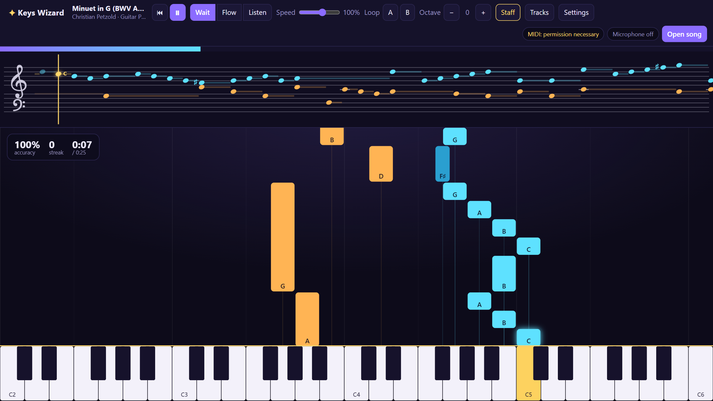
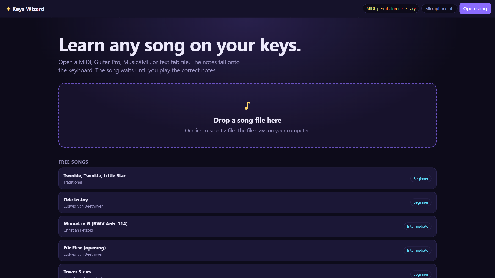
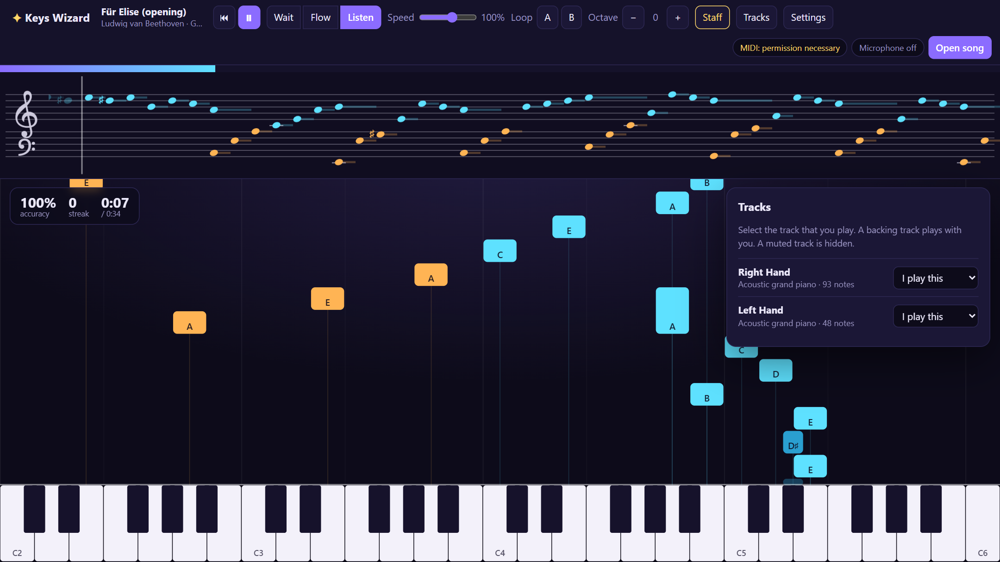
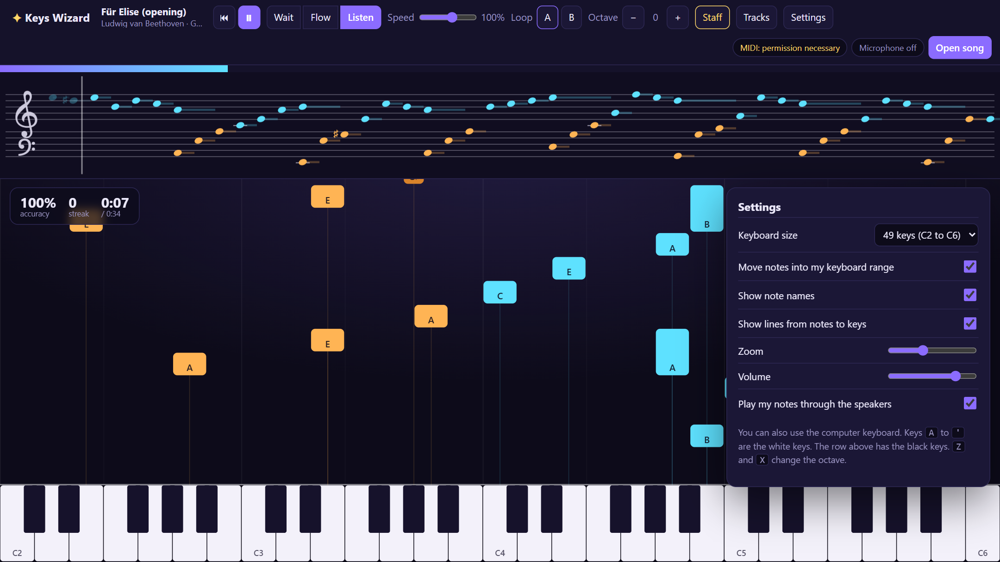

<div align="center">

# ✦ Keys Wizard

**Learn a song on your keyboard. The song waits for you.**

Open a MIDI, Guitar Pro, MusicXML, or text tab file in your browser.
The notes fall onto a keyboard on the screen.
The song stops at each note until you play the correct key.

[](LICENSE)
[](public/songs/README.md)




</div>

## Contents

- [What it does](#what-it-does)
- [Screenshots](#screenshots)
- [Start the app](#start-the-app)
- [How to use it](#how-to-use-it)
- [File types](#file-types)
- [Limits](#limits)
- [Songs in this repository](#songs-in-this-repository)
- [Work on the code](#work-on-the-code)
- [License](#license)

## What it does

| | |
| --- | --- |
| **Reads your files** | MIDI, Guitar Pro, MusicXML, alphaTex, and text tab. |
| **Hears your keyboard** | Connect a USB MIDI keyboard. The app finds it. |
| **Waits for you** | In Wait mode, the song stops at each note or chord until you play it. |
| **Shows the sheet music** | A treble and bass staff moves above the notes. You learn where each key is on the staff. |
| **Fits your keyboard** | The app moves the song by octaves to fit 25, 49, 61, 76, or 88 keys. |
| **Lets you select your part** | For each track, you play it, or the app plays it, or it is muted. |
| **Helps you practice** | Change the speed from 25% to 150%. Repeat a hard part with a loop. See your accuracy. |
| **Makes sound** | A small synthesizer plays your notes. A keyboard with no speakers is sufficient. |
| **Keeps your files private** | Your song files stay in your browser. The app does not upload them. |

The app was made for an M-Audio Keystation 49 MK3. It is written to work with any USB MIDI keyboard.

## Screenshots

**The start page.** Drop a file, or select one of the free songs.



**Listen mode and the Tracks panel.** The song plays. Blue is the right hand. Orange is the left hand.



**Settings.**



## Start the app

You must have [Node.js](https://nodejs.org) 20 or later.

```bash
npm install
```

```bash
npm run dev
```

Open http://localhost:5183 in Chrome, Edge, or Firefox.

The browser asks for permission to use MIDI devices. Select **Allow**.

> MIDI and the microphone work only on `localhost` or on an `https` page.

## How to use it

1. Connect your MIDI keyboard to the computer.
2. Open the app. The top bar shows the name of your keyboard.
3. Drop a song file on the page, or select a free song.
4. Play the bright key. The song starts.
5. Play each note when it gets to the keyboard. In Wait mode, the song waits for you.

### The three modes

| Mode | What the song does |
| --- | --- |
| **Wait** | It stops at each note until you play the correct key. Use this mode to learn the notes. |
| **Flow** | It does not stop. Play each note in time. The app counts the notes that you miss. |
| **Listen** | It plays all the notes. You watch and listen. |

### Controls

| Control | What it does |
| --- | --- |
| **Speed** | Makes the song slower or faster. Double-click to go back to 100%. |
| **Loop A / B** | **A** sets the start of the loop. **B** sets the end. **✕** removes the loop. |
| **Octave − / +** | Moves all the notes one octave down or up. |
| **Staff** | Shows or hides the sheet music. |
| **Tracks** | Sets the part that you play. |
| **Settings** | Keyboard size, note names, guide lines, zoom, and volume. |

### Keys on the computer keyboard

| Key | What it does |
| --- | --- |
| `Space` | Play or pause |
| `Home` | Start the song again |
| `Esc` | Close a panel |
| `A` to `'` | The white keys |
| `W` `E` `T` `Y` `U` `O` `P` | The black keys |
| `Z` and `X` | One octave down or up |

### Colors

- **Blue and orange notes** are the notes that you play. Each track has one color.
- **Gray notes** are a backing track. The app plays them.
- **A gold key** is the key to play now.
- **A green key** is a correct note. **A red key** is an incorrect note.

## File types

| Type | Extensions | Notes |
| --- | --- | --- |
| MIDI | `.mid` `.midi` `.kar` | |
| Guitar Pro | `.gp3` `.gp4` `.gp5` `.gpx` `.gp` | The app reads repeats and tempo changes. |
| MusicXML | `.musicxml` `.xml` `.mxl` | |
| alphaTex | `.alphatex` `.atex` | |
| Text tab | `.txt` `.tab` | Guitar with 6 or 7 strings. Bass with 4 or 5 strings. |

Text tab has no rhythm. The app plays each column as one sixteenth note. To set the speed, put a line such as `Tempo: 90` in the file.

## Limits

These are the things that the app does not do, or does not do well.

- **The staff shows pitch only.** It has note heads, ledger lines, and sharps. It has no stems, beams, rests, bar lines, or flats.
- **The microphone hears one note at a time.** It cannot hear chords. It accepts the correct note in any octave. A MIDI keyboard is more accurate.
- **There is no drum sound.** Drum tracks are muted.
- **The sound is a simple synthesizer.** It is not a recorded piano.
- **Guitar techniques are not shown.** Bends and slides play, but the app shows only the notes.
- **Safari does not support MIDI.** Use Chrome, Edge, or Firefox.
- **The app was not tested with many keyboards.** If your keyboard does not work, open an issue.

## Songs in this repository

The app includes five songs. Each one is in the public domain, or was written for this project. The arrangements have the CC0 license. You can use them for any purpose. See [public/songs/README.md](public/songs/README.md).

**This repository contains only songs that we have permission to share.**

Do not send a pull request with a tab or a MIDI file of a song that has copyright. The full rule is in [AGENTS.md](AGENTS.md).

You can practice your own song files. Drop them into the app. They stay on your computer.

## Work on the code

```bash
npm test
```

```bash
npm run build
```

| Command | What it does |
| --- | --- |
| `npm run dev` | Starts the app at http://localhost:5183 |
| `npm test` | Runs the unit tests |
| `npm run typecheck` | Does a check of the TypeScript types |
| `npm run build` | Makes the static site in `dist/` |
| `npm run songs` | Builds the songs in `public/songs/` from `songs-src/` |

The app uses Vite and TypeScript. It has no UI framework. [AGENTS.md](AGENTS.md) shows where each part of the code is.

## License

- Code: [MIT](LICENSE)
- Song arrangements: [CC0 1.0](https://creativecommons.org/publicdomain/zero/1.0/)

The app uses these libraries:

- [alphaTab](https://alphatab.net) (MPL-2.0) reads Guitar Pro and MusicXML files.
- [@tonejs/midi](https://github.com/Tonejs/Midi) (MIT) reads MIDI files.
